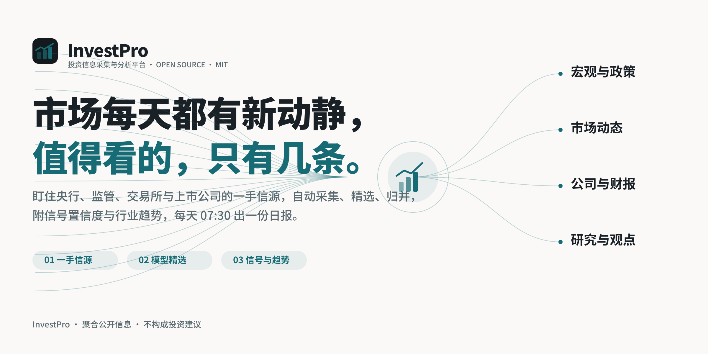

<p align="center">
  <picture>
    <source media="(prefers-color-scheme: dark)" srcset="docs/assets/banner-dark.png">
    
  </picture>
</p>

<p align="center">
  <a href="LICENSE"></a>
  
  
  
</p>

<p align="center">
  <b>An investment information platform that finds the news and writes the daily briefing by itself.</b><br>
  It watches first-party sources — central banks, regulators, exchanges and listed companies — screens and writes Chinese titles and summaries with a model, and adds a signal-confidence score and sector trends.
</p>

<p align="center">
  <a href="README.md">简体中文</a> · <b>English</b>
</p>

<p align="center">
  <a href="#run-it">Run it</a> ·
  <a href="#how-it-works">How it works</a> ·
  <a href="#documentation">Documentation</a>
</p>

<br>

## What this is

InvestPro collects material from high-confidence sources (central banks, regulators, exchange filings, company disclosures, financial media and research), screens it twice with independent model scores, and writes Chinese titles and answer-first summaries. Reports of the same thing are clustered into one event, ranked by how many independent sources are talking about it. On top of that it computes a **signal confidence** score (source tier, independent coverage, discussion) and **sector trends** (last 7 days vs the 7 before), and publishes a daily briefing at 07:30 Beijing time.

**Disclaimer**: this site aggregates public information. Nothing here is investment advice.

## Sources

36 preset sources, all verified working, in three tiers:

- **T1 first-party (23)**: Federal Reserve (press, speeches, enforcement orders, banking applications, FEDS Notes), ECB, Bank of England, Bank of Japan, SEC press releases, EIA, Liberty Street Economics, Apple Newsroom, SEC EDGAR 8-K filings for Apple, Microsoft, NVIDIA, Tesla, Alphabet, Amazon, Meta, JPMorgan and Berkshire, plus China's National Bureau of Statistics (data releases and data interpretations).
- **T1.5 official media and institutions (2)**: Securities Daily (a CSRC-designated disclosure outlet) and Oxford Economics.
- **T2 media and professionals (11)**: WSJ Markets, CNBC Economy/Finance, MarketWatch, Seeking Alpha Market Currents, OilPrice, Mining.com, Net Interest, The Overshoot, TMTPost and 199IT.

Chinese sources (WeChat accounts, X accounts) can be added in the admin's source page; see [sources](docs/sources.md). The CSRC, SSE, CNInfo and HKEX sites render their lists in the browser and expose no subscribable feed, so they are not preset; use the push API or a WeChat account for them.

## What you get

Six source kinds (RSS, web lists, JSON APIs, X accounts, WeChat accounts, your own pushes) with tiered admission thresholds and adaptive fetch intervals; selection by two independent scores; Chinese titles, answer-first summaries and a reading reason; events with digests; a hot ranking; **/signals** (signal confidence per event) and **/trends** (sector momentum); daily, weekly and monthly briefings; topic pages and search; local reading settings; RSS, public API, MCP and Agent Markdown; and an admin for sources, content diagnostics, selection evaluation, per-step model choice, budget breakers and run history.

## Run it

Needs [Docker](https://docs.docker.com/get-started/get-docker/), Node.js 24 (for `init-env`), and an OpenAI-compatible model API key (DeepSeek, Qwen, Zhipu all work).

```bash
git clone <your repo> investpro
cd investpro
node scripts/init-env.ts --llm-key <your model API key>
docker compose up -d --build
```

Open <http://localhost:3000>. The admin is at `/admin` (password in `.env`). Content starts after a minute or two; the first import takes about half an hour to process. See [deployment](docs/deploy.md) for running without Docker, domains, HTTPS and mainland China.

## Make it your field

This site is an industry instance of the open-source [AIHOT engine](https://github.com/KKKKhazix/AIHOT): the investment taxonomy, sources, prompts and thresholds live in `industry/` and `site/`; the engine code is in `apps/` and `packages/`. Follow [docs/customize.md](docs/customize.md) to swap the industry. The investment-specific `/signals` and `/trends` pages are the `modules/invest-signals/` module — remove it for another industry, or write your own module the same way.

The selection thresholds (T1 60 / T1_5 65 / T2 76) are the engine defaults and on the strict side; recalibrate them with your own labelled samples as described in [selection](docs/selection.md) before launch.

## Documentation

| Document | Contents |
|---|---|
| [Customize](docs/customize.md) | Site name, taxonomy, topics, sources, prompts, thresholds, models, brand |
| [Sources](docs/sources.md) | The six source kinds, tiers and full text, fetch intervals, the push API |
| [Selection](docs/selection.md) | How material becomes selected, and how to calibrate |
| [Grouping](docs/grouping.md) | Event relations and the paired-sample evaluation |
| [Digest evaluation](docs/story-digest-evaluation.md) | Comparing digest prompts side by side |
| [Deployment](docs/deploy.md) | Docker, domains and HTTPS, mainland China, updates, backups |
| [Architecture](docs/architecture.md) | Three processes, modules, migrations, exits, tests |

Stack: Node.js 24 · TypeScript · React Router (SSR) · Fastify · PostgreSQL · pg-boss · Tailwind CSS · Docker Compose.

## License

Code under the [MIT License](LICENSE).
